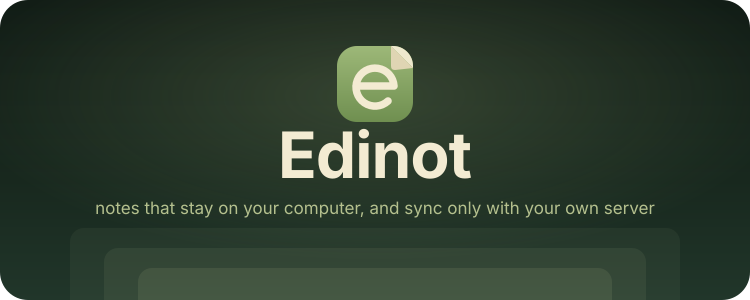
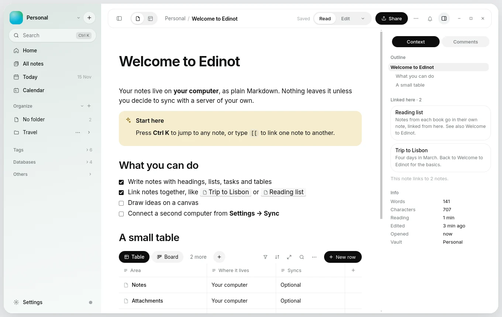
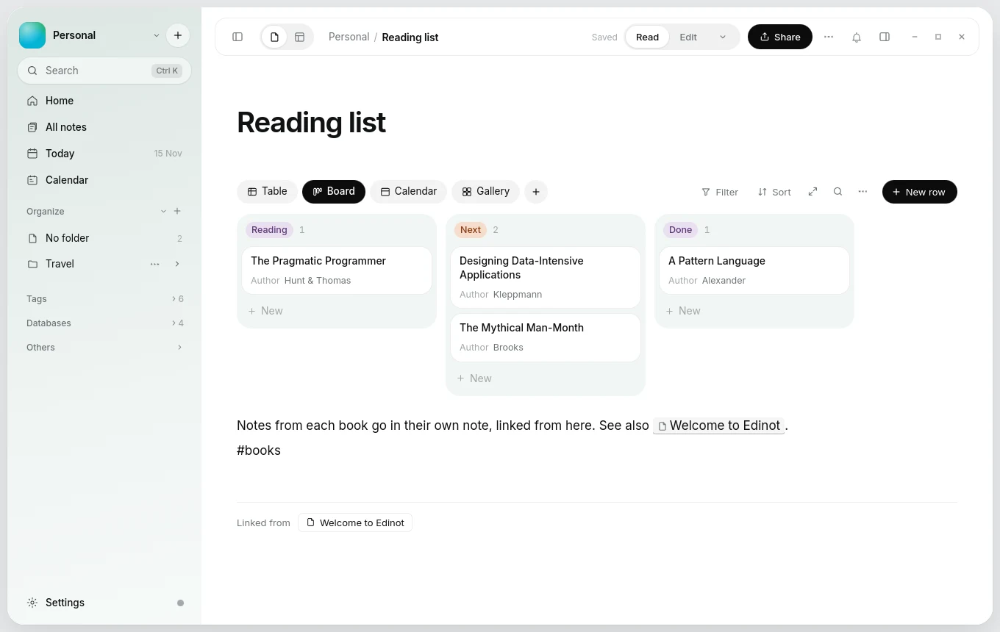
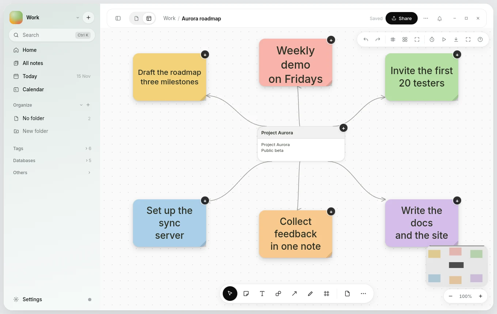

<div align = center>



<br>

**Notas que se quedan en tu ordenador y solo se sincronizan con tu propio servidor.**

[English](README.md) · [Discord](https://discord.gg/N7kbYC49b2) · [Ko-fi](https://ko-fi.com/k4ditano)

</div>

Edinot es una app de notas que guarda tus notas donde estás tú: en tu
ordenador, como Markdown plano, funcionando sin conexión y sin cuenta. Notas,
lienzos, bases de datos y calendario conviven en el mismo sitio. Cuando quieres
las notas en un segundo ordenador, las sincronizas a través de un servidor
**tuyo**, cifrado: no hay ninguna nube de Edinot por medio.

<div align = center>



</div>

## Novedades de la 1.3

- **Local primero, de verdad**: Edinot ya no tiene cuentas, planes ni nube.
  Tus notas viven en un proceso local pequeño, el *hub*, que la app, la línea
  de comandos y tus asistentes de IA leen sin red.
- **Sincronización con tu propio servidor**: el hub se instala en un VPS o en
  un PC siempre encendido con un comando, y cada ordenador se empareja con un
  enlace o un QR. La conexión va cifrada sin necesidad de dominio: el enlace
  lleva la huella del certificado del servidor y la app solo acepta ese.
- **Compartir un vault con otra persona**, de solo lectura o con escritura, y
  quitarle el acceso cuando quieras.
- **Sin IA dentro de la app**: Edinot no trae asistente. Claude, Codex o
  Cursor se conectan desde fuera por MCP, con permisos por vault.
- **Ajustes ordenados**: siete secciones en lugar de trece.
- **Las actualizaciones salen de las releases de este repositorio.**

## Qué trae

- **Notas en Markdown plano**: títulos, listas, tareas, código, avisos y
  tablas. Enlaza notas con `[[enlaces]]`, mira qué enlaza a la que lees y
  muévete por el esquema. Etiquetas, carpetas y varios *vaults*. Léelas,
  edítalas, o ambas a la vez.
- **Búsqueda que lo encuentra todo**: `Ctrl K` abre una paleta que busca
  nombres, el texto de las notas, lienzos, bases de datos y comandos, con vista
  previa de cada resultado.
- **Calendario y una nota para cada día**, con tareas y eventos con fecha, y
  sincronización opcional en ambos sentidos con Google Calendar.
- **Plantillas**, una extensión de navegador (**Web Clipper**) y **exportación**
  a una carpeta de archivos Markdown que puedes leer sin Edinot.
- **Español e inglés**, según el idioma de tu sistema.

### Bases de datos

Cualquier tabla de Markdown puede ser una base de datos, y en el archivo sigue
siendo una tabla normal. Cambia las mismas filas entre **Tabla**, **Tablero**,
**Calendario** y **Galería**, con filtros y orden.

<div align = center>



</div>

### Lienzos

Una pizarra que vive dentro de una nota: notas adhesivas, texto, formas,
flechas, dibujo a mano, marcos, y otras notas o imágenes como tarjetas, con
minimapa y modo presentación.

<div align = center>



</div>

### Sincronizar, cuando quieras

Nada se sincroniza hasta que lo pides. En **Ajustes → Sincronización** pegas el
enlace que te dio tu servidor, y la app copia tus notas allí y mantiene los dos
lados al día. Cada ordenador recibe su propia credencial, así que puedes quitar
uno sin tocar los demás.

## Instalar

Descarga el instalador de tu sistema desde las
[releases](https://github.com/k4ditano/edinot/releases) (Windows: `.exe`;
macOS: `.zip`; Linux: `.AppImage` o `.deb`). Los instaladores **todavía no
están firmados**: Windows y macOS avisarán la primera vez. La app comprueba las
releases de este repositorio y se actualiza al reiniciar.

## Tu propio servidor

Necesitas un servidor tuyo: un VPS pequeño o un PC siempre encendido (Linux con
Node.js 20 o superior). Copia `edinot-hub-linux.tar.gz` de las releases al
servidor y:

```sh
tar xzf edinot-hub-linux.tar.gz
sudo sh install.sh
```

Instala el hub como servicio e imprime un enlace y un QR para tu primer
ordenador. En la app, pega el enlace en **Ajustes → Sincronización**; para más
ordenadores, vuelve a ejecutar `edinot pair` en el servidor. Más detalles, y
Docker, en [`deploy/hub/LEEME.md`](deploy/hub/LEEME.md).

### Compartir un vault

```sh
edinot share Trabajo --read-only   # un enlace que abre solo ese vault, para leer
edinot shares                      # quién tiene acceso a qué
edinot devices revoke <id>         # quitar uno: deja de sincronizar al instante
```

La unidad de compartir es el **vault**: el texto de cada nota vive dentro del
documento de su vault, así que no se puede compartir una carpeta o una nota
suelta. Quien recibe el acceso no puede leer ni cambiar tus otros vaults, pero
sí ve sus nombres. Quitarle el acceso detiene la sincronización futura; no puede
borrar lo que ya se copió a su ordenador.

## Terminal y MCP

Tus notas se alcanzan desde la terminal y desde asistentes de IA, con la app
abierta o sin ella. **Ajustes → Conexiones → Terminal** instala el comando
`edinot` (`edinot help` lista todo). La misma página configura el servidor MCP
(127 herramientas) para Claude Desktop, Claude Code, Codex y Cursor con un
clic, con permisos por vault. Edinot no tiene IA propia: da un sitio de trabajo
a los asistentes que ya usas.

## Lo que todavía no hace

- **No hay app para el móvil**, ni sincronización directa entre ordenadores:
  se encuentran en tu servidor.
- Se comparte **por vault**, no por carpeta ni por nota.
- Una app de escritorio se sincroniza con **un** servidor a la vez.
- Linux es la plataforma más probada; las versiones de Windows y macOS se
  publican pero han tenido menos uso.

## Compilarlo tú

```sh
npm ci
npm start       # compila y abre la app
npm test        # las pruebas
npm run dist    # instaladores para tu plataforma
```

Antes de abrir una pull request, lee la [política de IA](AI_POLICY.md).

## Licencia

[BSD de 3 cláusulas](LICENSE). Las dependencias conservan sus propias licencias.
