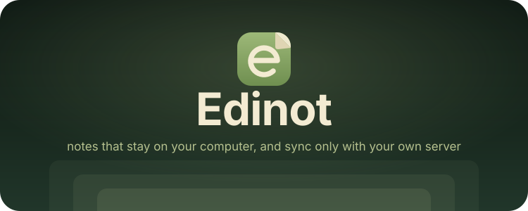
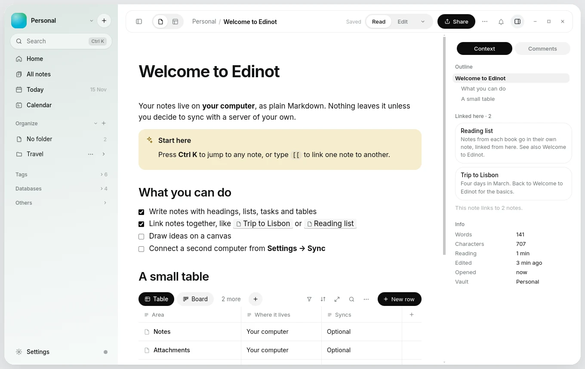
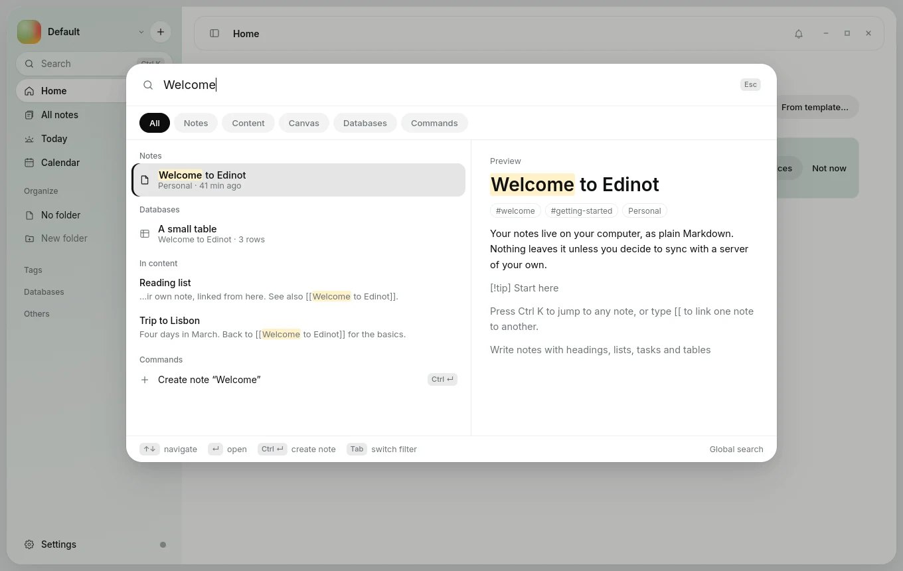
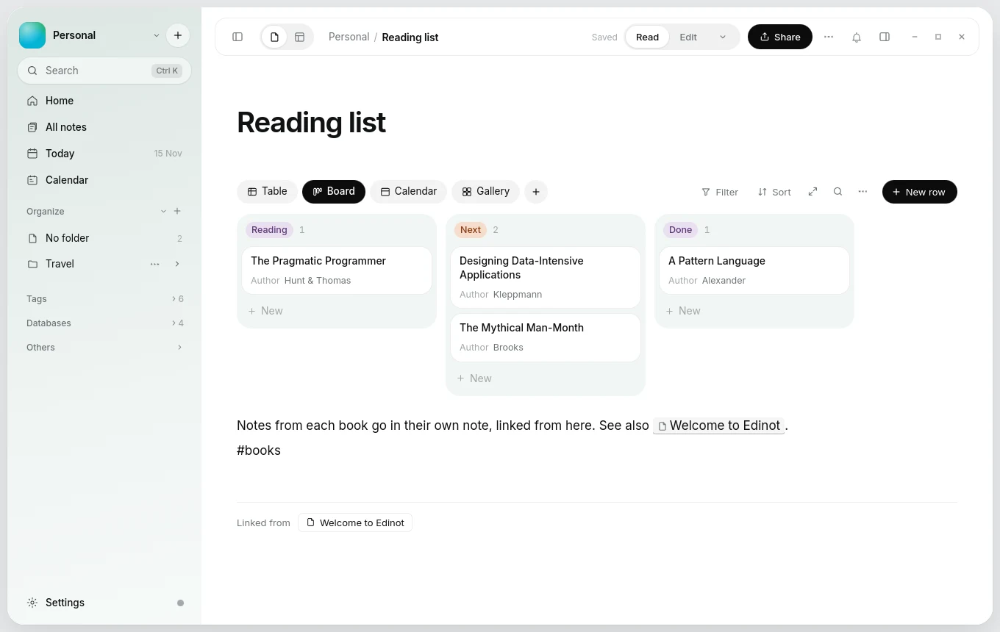
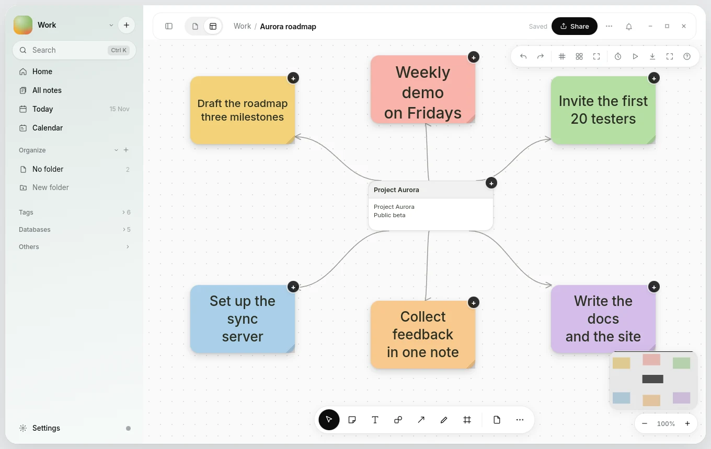
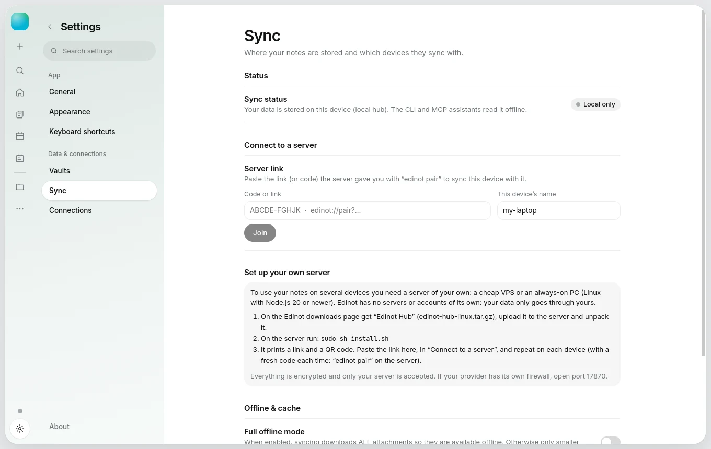

<div align = center>



<br>

[![Badge License]][License]
![Badge Language]
![Badge Commit]
[![Badge Issues]][Issues]
[![Badge Discord]][Discord]
[![Badge X]][X]
[![Badge Ko-fi]][Ko-fi]

<br>

Edinot is a note app that keeps your notes where you are: on your computer,
as plain Markdown, working offline with no account. Notes, canvases,
databases and a calendar live side by side. When you want your notes on a
second computer, you sync them through a server of your own, encrypted — there
is no Edinot cloud in between.

<br>

---

**[<kbd> <br> Install <br> </kbd>][Install]**
**[<kbd> <br> Features <br> </kbd>][Features]**
**[<kbd> <br> Your own server <br> </kbd>][Server]**
**[<kbd> <br> CLI and MCP <br> </kbd>][CLI]**
**[<kbd> <br> Español <br> </kbd>][Leeme]**
**[<kbd> <br> Discord <br> </kbd>][Discord]**

---

<br>

</div>

# What's new

- **1.3 · Local-first, for real**: Edinot no longer has accounts, plans or a
  cloud. Your notes live in a small local process, the *hub*, that the app,
  the command line and your AI assistants all read without a network.
- **Sync through your own server**: install the hub on a VPS or an always-on
  PC with one command, and pair each computer with a link or a QR code. The
  connection is encrypted without needing a domain: the link carries the
  fingerprint of the server's certificate, and the app accepts only that one.
- **Share a vault with someone else**, read-only or read-write, and remove
  their access whenever you want (see [what that does and does not cover][Sharing]).
- **No AI inside the app**: Edinot does not ship an assistant. If you use
  Claude, Codex or Cursor, they connect from outside through MCP, with
  per-vault permissions.
- **Settings, tidied up**: seven sections instead of thirteen.
- **Updates come from this repository's releases**, and a new build of the
  app checks them by itself.

Every change, in the [commits][Commits].

# Features

<div align = center>



</div>

- **Notes in plain Markdown**: headings, lists, tasks, code, callouts and
  tables. Link notes with `[[wikilinks]]`, see what links to the one you are
  reading, and jump around the outline. Tags, folders and several *vaults*.
  Read, edit, or both at once.
- **Search that finds everything**: `Ctrl K` opens a palette that searches
  names, the text inside notes, canvases, databases and commands, with a
  preview of each result.
- **A calendar and a note for every day**: dated tasks and events in one
  calendar, a daily note one keystroke away, and optional two-way sync with
  Google Calendar.
- **Templates**, a **Web Clipper** browser extension, and **export** to a
  folder of Markdown files you can read without Edinot.
- **English and Spanish**, following your system language.

<div align = center>



</div>

### Databases

Any Markdown table can be a database, and it stays a plain table in the file.
Switch the same rows between **Table**, **Board**, **Calendar** and
**Gallery**, with filters and sorting.

<div align = center>



</div>

### Canvases

A whiteboard that lives in a note: stickies, text, shapes, arrows, freehand
drawing, frames, and other notes or images as cards, with a minimap and a
presentation mode.

<div align = center>



</div>

### Sync, when you want it

Nothing syncs until you ask. In **Settings → Sync** you paste the link your
server gave you, and the app copies your notes there and keeps both sides in
step. Each computer gets its own credential, so you can remove one without
touching the others.

<div align = center>



</div>

# Install

Download the installer for your system from the
[releases][Releases]:

| System | File |
| --- | --- |
| Windows | `Edinot-Setup-<version>-x64.exe` (installer) or `Edinot-<version>-x64-portable.exe` |
| macOS | `Edinot-<version>-arm64-mac.zip` (Apple silicon) or `Edinot-<version>-mac.zip` (Intel) |
| Linux | `Edinot-<version>.AppImage` (`chmod +x`, then run it) or `edinot_<version>_amd64.deb` |

The installers **are not code-signed yet**: Windows and macOS will warn you the
first time you open them. The app checks this repository's releases for updates
and installs them when you restart.

# Your own server

To use your notes on several computers you need a server of your own: a small
VPS, or a PC that is always on (Linux with Node.js 20 or newer). Take
`edinot-hub-linux.tar.gz` from the [releases][Releases], copy it to the
server, and:

```sh
tar xzf edinot-hub-linux.tar.gz
sudo sh install.sh
```

It installs the hub as a service and prints a link and a QR code for your
first computer. In the app, paste the link in **Settings → Sync**; for more
computers, run `edinot pair` on the server again. The connection is encrypted
with a certificate the hub creates for itself, so you need neither a domain nor
a reverse proxy (you can still put one in front). More in
[`deploy/hub/README.md`](deploy/hub/README.md), including Docker.

### Sharing a vault

```sh
edinot share Work --read-only    # a link that opens only that vault, to read
edinot shares                    # who has access to what
edinot devices revoke <id>       # remove one: it stops syncing at once
```

The unit of sharing is the **vault**: the text of every note lives inside its
vault's document, so a single folder or note cannot be shared on its own. The
person you share with can neither read nor change your other vaults, but they do
see their names. Removing them stops future syncing; it cannot erase what was
already copied to their computer.

# CLI and MCP

Your notes are reachable from the terminal and from AI assistants, with or
without the app open. **Settings → Connections → Terminal** installs the
`edinot` command:

```sh
edinot list                      # your notes
edinot read "Welcome to Edinot"  # one note, as Markdown
echo "# Idea" | edinot write Idea --vault Personal
edinot search "sync server"
edinot vaults                    # list vaults, or: edinot vaults create <name>
edinot export ~/notes --attachments   # everything as Markdown files
edinot status                    # where your data lives and what it syncs with
```

The same **Connections** page sets up the MCP server (127 tools to read,
write, search, move, comment on notes and draw on canvases) for Claude Desktop,
Claude Code, Codex and Cursor in one click, with permissions per vault. Edinot
has no AI of its own: it gives the assistants you already use a place to work.

# What it does not do (yet)

- There is **no phone app**, and no direct computer-to-computer sync: your
  computers meet at your server.
- Sharing is **per vault**, not per folder or note.
- A desktop app syncs with **one** server at a time.
- Linux is the platform tested the most; Windows and macOS builds are
  published but have had less use.

# Build it yourself

```sh
npm ci
npm start       # builds and opens the app
npm test        # the test suite
npm run dist    # installers for your platform
```

The layout: `editor.jsx` and `ui/` are the interface, `electron/` the main
process, `hub/` the hub and its server mode, `cli/` and `mcp/` the terminal and
assistant interfaces, `shared/` the code they share, and `deploy/hub/` the
server install. Read the [AI policy][AI Policy] before you open a pull request.

# License

[BSD 3-Clause][License]. The dependencies keep their own licenses.

[Badge License]: https://img.shields.io/badge/license-BSD--3--Clause-9db878?style=flat-square
[Badge Language]: https://img.shields.io/badge/made%20with-Electron%20%2B%20Yjs-6f8f50?style=flat-square
[Badge Commit]: https://img.shields.io/github/last-commit/k4ditano/edinot?style=flat-square&color=9db878
[Badge Issues]: https://img.shields.io/github/issues/k4ditano/edinot?style=flat-square&color=6f8f50
[Badge Discord]: https://img.shields.io/badge/chat-Discord-5865f2?style=flat-square&logo=discord&logoColor=white
[Badge X]: https://img.shields.io/badge/follow-@k4ditano-000000?style=flat-square&logo=x
[Badge Ko-fi]: https://img.shields.io/badge/support-Ko--fi-ff5e5b?style=flat-square&logo=ko-fi&logoColor=white

[Install]: #install
[Features]: #features
[Server]: #your-own-server
[CLI]: #cli-and-mcp
[Sharing]: #sharing-a-vault
[Leeme]: LEEME.md
[License]: LICENSE
[AI Policy]: AI_POLICY.md
[Releases]: https://github.com/k4ditano/edinot/releases
[Commits]: https://github.com/k4ditano/edinot/commits/main
[Issues]: https://github.com/k4ditano/edinot/issues
[X]: https://x.com/k4ditano
[Discord]: https://discord.gg/N7kbYC49b2
[Ko-fi]: https://ko-fi.com/k4ditano
